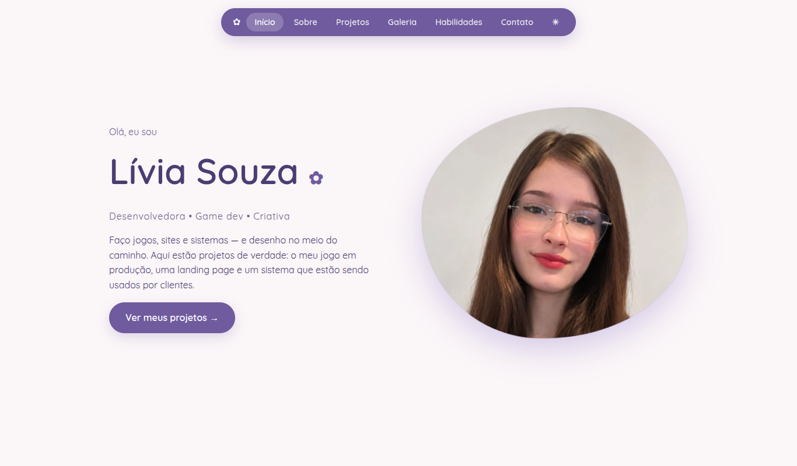
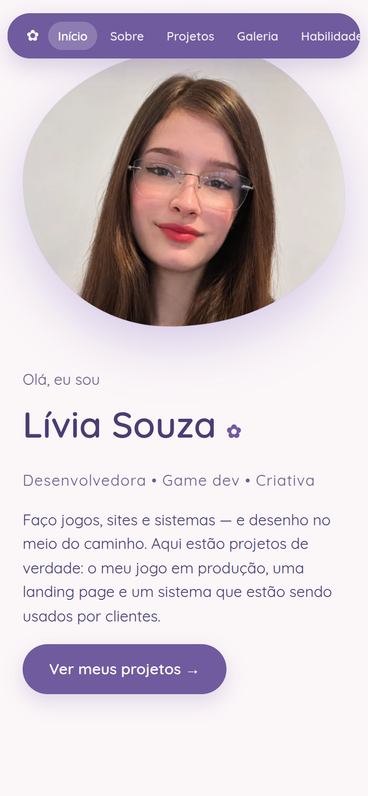

# Portfólio — Lívia de Souza Faria

### ▶ [Abrir o portfólio ao vivo](https://foxylyv.github.io/portfolio/)

Desenvolvedora full stack júnior e game dev. Abra o portfólio para ver meus projetos: jogos,
a landing page de uma consultora de seguros, o sistema de estoque e encomendas de uma rede de
cafeterias (Django + React) e minhas artes digitais.

| Início | Celular |
|---|---|
|  |  |

## Projetos com demonstração

| Projeto | Ao vivo | Código |
|---|---|---|
| Sistema de Estoque e Encomendas (Django + React) | [Abrir a demonstração](https://foxylyv.github.io/sistema-estoque-encomendas/) | [Repositório](https://github.com/Foxylyv/sistema-estoque-encomendas) |
| Landing page — Consultora de Seguros | [Abrir o site](https://foxylyv.github.io/landing-page-consultora/) | [Repositório](https://github.com/Foxylyv/landing-page-consultora) |

## Contato
- E-mail: liviasouza311@gmail.com
- LinkedIn: [linkedin.com/in/livia-souza-dev01001](https://www.linkedin.com/in/livia-souza-dev01001/)
